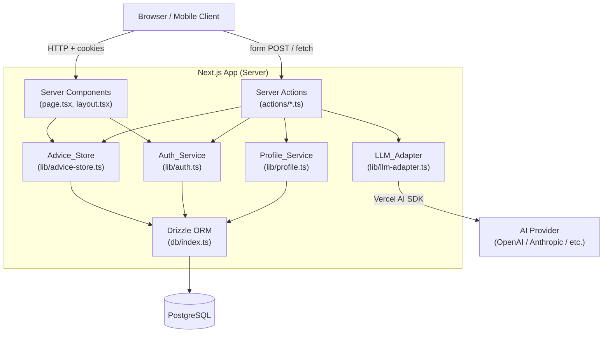
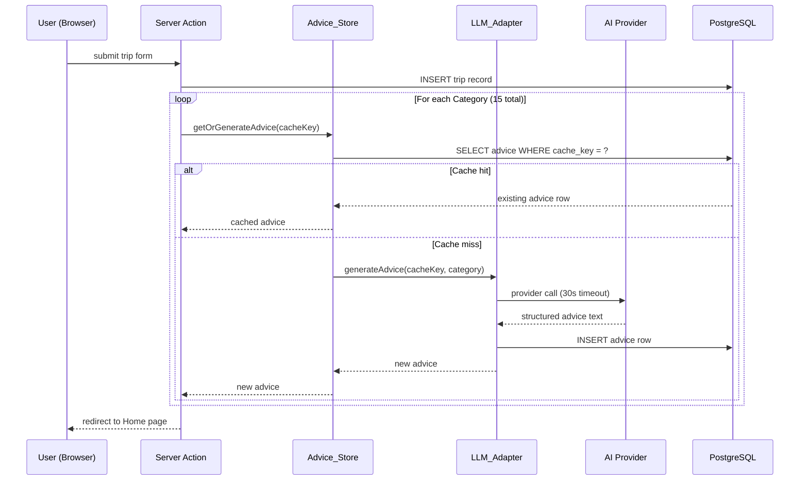
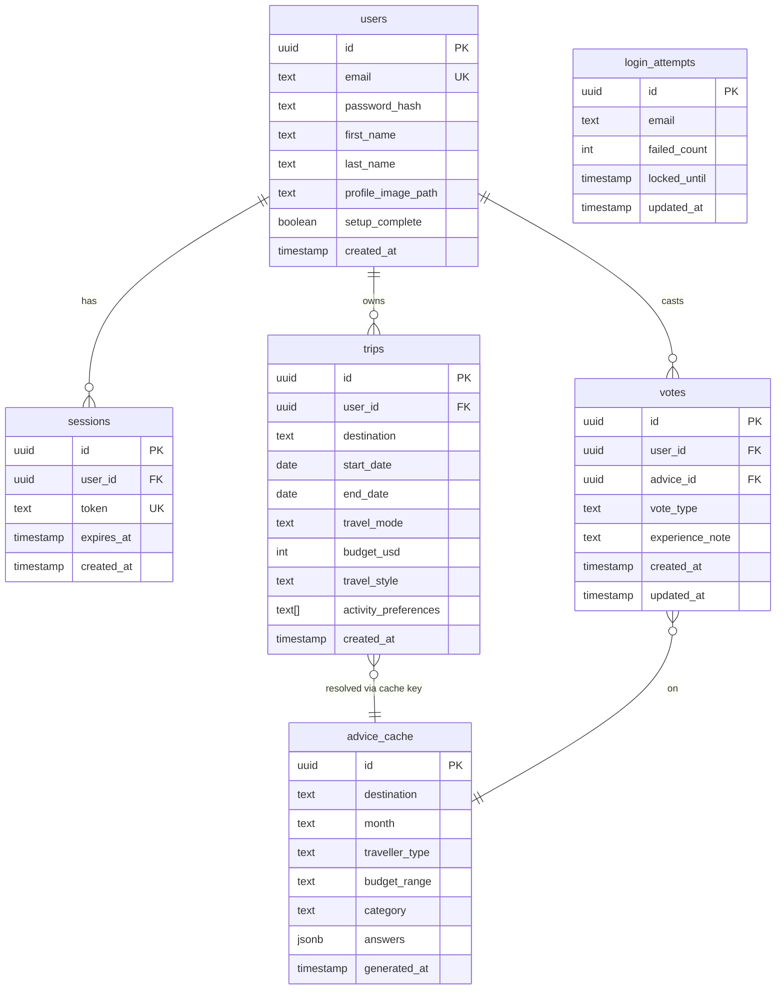

# Design Document — MVPTravel Reality

## Overview

MVPTravel Reality is a mobile-first Next.js (App Router) web application that gives travellers structured, AI-generated, category-based advice for 10 hard-coded destinations. Users create a "Trip" by specifying destination, dates, travel mode, budget, style, and activity preferences. The system maps that Trip to a **Cache Key** of `(destination, month, traveller_type, budget_range)` and checks PostgreSQL for previously generated advice before calling an AI provider. Users can vote on advice accuracy and contribute personal experience notes.

### Key Design Decisions

| Decision | Choice | Rationale |
|---|---|---|
| Framework | Next.js 15 App Router | Server Components + Server Actions keep secrets server-side, reduce client bundle, enable streaming |
| ORM | Drizzle ORM | Lightweight, type-safe, SQL-first; minimal runtime overhead vs Prisma |
| Database | PostgreSQL | Single persistence store for data, sessions, and AI advice cache |
| AI abstraction | Vercel AI SDK + custom `LLM_Adapter` module | Vercel AI SDK provides a unified `LanguageModelV1` interface; `LLM_Adapter` wraps it to add retry, timeout, and provider-swap logic |
| Auth | Custom session tokens stored in PostgreSQL | Avoids third-party auth service dependency; sessions stored in `sessions` table with expiry |
| Caching layer | DB-only (no Redis) | Cache key lookup is a single indexed `SELECT`; volume at MVP scale doesn't justify a separate cache tier |
| Styling | Tailwind CSS (mobile-first) | Utility-first, built-in responsive breakpoints, zero runtime overhead |
| Image storage | Local filesystem (MVP) / object storage path | Profile images stored as file path references; swap to S3/R2 post-MVP without schema change |

---

## Architecture

The application follows a **server-centric monolith** pattern — all data access, auth, and AI calls happen in Server Components or Server Actions. Client Components are used only for interactive UI (forms, voting, card expand/collapse).



### Request Flow: Trip Creation & Advice Generation



---

## Components and Interfaces

### Directory Structure

```
src/
├── app/
│   ├── (auth)/
│   │   └── login/page.tsx
│   ├── (setup)/
│   │   └── setup/page.tsx
│   ├── (app)/
│   │   ├── layout.tsx            ← auth guard
│   │   ├── home/[tripId]/page.tsx
│   │   ├── destinations/page.tsx
│   │   ├── trip/new/page.tsx
│   │   └── profile/page.tsx
│   └── api/
│       └── auth/route.ts         ← session cookie endpoint
├── components/
│   ├── ui/                       ← primitive components (Button, Input, Modal)
│   ├── cards/
│   │   ├── ConciseCard.tsx
│   │   └── ExpandedCard.tsx
│   ├── forms/
│   │   ├── LoginForm.tsx
│   │   ├── SetupForm.tsx
│   │   └── TripForm.tsx
│   └── voting/
│       └── VoteButtons.tsx
├── lib/
│   ├── auth.ts                   ← Auth_Service
│   ├── profile.ts                ← Profile_Service
│   ├── advice-store.ts           ← Advice_Store
│   ├── llm-adapter.ts            ← LLM_Adapter
│   └── destinations.ts           ← hard-coded destination list
├── db/
│   ├── index.ts                  ← Drizzle client
│   └── schema.ts                 ← all table definitions
├── actions/
│   ├── auth.ts
│   ├── trip.ts
│   ├── advice.ts
│   └── vote.ts
└── middleware.ts                  ← session guard for (app) routes
```

### Auth_Service (`lib/auth.ts`)

```typescript
interface AuthService {
  // Validates credentials, creates session, returns session token
  login(email: string, password: string): Promise<{ token: string; expiresAt: Date } | AuthError>
  // Validates session token from cookie, returns user or null
  getSession(token: string): Promise<User | null>
  // Invalidates session token
  logout(token: string): Promise<void>
  // Checks and increments failed login counter; locks account after 5 attempts
  checkRateLimit(email: string): Promise<{ locked: boolean; remainingMinutes?: number }>
}
```

Session tokens are 32-byte random hex strings stored in the `sessions` table. Passwords are hashed with `bcrypt` (cost factor 12). Middleware reads the `session_token` HttpOnly cookie on every request to `(app)/**` routes.

### LLM_Adapter (`lib/llm-adapter.ts`)

```typescript
interface LLMAdapter {
  // Generate structured advice for a (cacheKey, category) pair
  generateAdvice(params: {
    cacheKey: CacheKey
    category: Category
    subQuestions: string[]
  }): Promise<AdviceResult>

  // Generate a single-sentence summary for a Concise Card
  summarise(fullAdvice: string): Promise<string>
}

type CacheKey = {
  destination: string   // normalised to lower-case
  month: string         // e.g. "january"
  travellerType: TravelMode
  budgetRange: BudgetTier  // "budget" | "mid" | "luxury" derived from numeric USD value
}
```

The `LLM_Adapter` is implemented on top of the [Vercel AI SDK](https://sdk.vercel.ai/docs/foundations/providers-and-models), which exposes a unified `LanguageModelV1` interface across OpenAI, Anthropic, Google, and others. Swapping providers requires only changing the model import — calling code is unchanged. The adapter adds:
- A 30-second `AbortSignal` timeout per call
- Structured output parsing (category answers mapped to sub-question keys)
- Error capture + server-side logging

### Advice_Store (`lib/advice-store.ts`)

```typescript
interface AdviceStore {
  // Returns cached advice or null
  findByCacheKey(key: CacheKey, category: Category): Promise<AdviceRecord | null>
  // Persists newly generated advice
  save(advice: NewAdviceRecord): Promise<AdviceRecord>
  // Retrieves all advice for a trip (joins through cache key)
  getForTrip(tripId: string): Promise<AdviceRecord[]>
}
```

Cache key lookups use a composite index on `(destination, month, traveller_type, budget_range, category)`. All string comparisons use `LOWER()` or `CITEXT` columns.

### Profile_Service (`lib/profile.ts`)

```typescript
interface ProfileService {
  create(data: NewProfile): Promise<Profile>
  update(userId: string, data: Partial<UpdateProfile>): Promise<Profile>
  deleteAccount(userId: string): Promise<void>  // cascades trips and votes
  validateImage(file: File): ImageValidationResult
}
```

---

## Data Models

### Entity Relationship Diagram



### Drizzle Schema Highlights

```typescript
// db/schema.ts

export const adviceCache = pgTable('advice_cache', {
  id: uuid('id').primaryKey().defaultRandom(),
  destination: citext('destination').notNull(),
  month: citext('month').notNull(),
  travellerType: citext('traveller_type').notNull(),
  budgetRange: text('budget_range').notNull(), // 'budget' | 'mid' | 'luxury'
  category: text('category').notNull(),
  answers: jsonb('answers').notNull(), // Record<subQuestionKey, string>
  generatedAt: timestamp('generated_at').defaultNow(),
}, (t) => ({
  cacheKeyIdx: uniqueIndex('advice_cache_key_idx')
    .on(t.destination, t.month, t.travellerType, t.budgetRange, t.category),
}))

export const loginAttempts = pgTable('login_attempts', {
  id: uuid('id').primaryKey().defaultRandom(),
  email: citext('email').notNull().unique(),
  failedCount: integer('failed_count').notNull().default(0),
  lockedUntil: timestamp('locked_until'),
  updatedAt: timestamp('updated_at').defaultNow(),
})
```

### Budget Range Derivation

The numeric USD budget value from the Trip form is normalised to a `budget_range` tier for the Cache Key:

| USD Range | Tier |
|---|---|
| $1 – $99/day | `budget` |
| $100 – $499/day | `mid` |
| $500 – $1,000,000/day | `luxury` |

> **Rationale**: LLM advice for "$52/day" and "$78/day" is effectively identical. Bucketing to three tiers maximises cache reuse while still meaningfully differentiating advice quality.

### Hard-Coded Destinations

The 10 destinations are defined as a TypeScript constant in `lib/destinations.ts` rather than a database table, since they are fixed at launch and require no runtime modification. The list includes Costa Rica, Mallorca, and 8 further destinations set at deployment time.

---

## Correctness Properties

*A property is a characteristic or behavior that should hold true across all valid executions of a system — essentially, a formal statement about what the system should do. Properties serve as the bridge between human-readable specifications and machine-verifiable correctness guarantees.*

### Property 1: Cache Round-Trip (Idempotence + Case-Insensitivity)

*For any* valid combination of (destination, month, traveller_type, budget_range, category) — where the string components may be in any case — calling `getOrGenerateAdvice` once or many times SHALL always return the same advice content, SHALL result in exactly one row in `advice_cache` for that cache key, and SHALL treat key components that differ only in letter case as equal (e.g. `"Costa Rica"` and `"costa rica"` resolve to the same row).

**Validates: Requirements 4.2, 4.3**

---

### Property 2: Advice Write-Before-Read Consistency

*For any* newly generated AI Advice that is successfully persisted, a subsequent cache-key lookup for the same parameters SHALL find and return the record — i.e. the store is read-consistent immediately after write.

**Validates: Requirements 4.4, 4.6**

---

### Property 3: Vote Write Round-Trip

*For any* (userId, adviceId, voteType) triple, after casting a vote the Advice_Store SHALL contain exactly one vote record for that pair, and reading back that record SHALL return the same voteType that was written.

**Validates: Requirements 7.2, 7.6**

---

### Property 4: Vote Transition Preserves Uniqueness

*For any* sequence of vote changes on the same (userId, adviceId) pair, the `votes` table SHALL contain at most one row for that pair at all times, and that row SHALL always reflect the most recent vote cast.

**Validates: Requirements 7.2, 7.6**

---

### Property 5: Vote Retraction Leaves No Residual Record

*For any* user and advice answer where a vote exists, retracting that vote SHALL result in zero rows in `votes` for that (user_id, advice_id) pair.

**Validates: Requirements 7.7**

---

### Property 6: Experience Note Length Constraint

*For any* string submitted as an experience note, the note SHALL be accepted and saved if and only if its character count is between 1 and 500 inclusive; strings of length 0 or > 500 SHALL be rejected without being saved.

**Validates: Requirements 7.4, 7.8**

---

### Property 7: Trip Date Ordering Invariant

*For any* trip form submission, the system SHALL reject and SHALL NOT persist the trip if `start_date` is before the current calendar date OR if `end_date` is before `start_date`.

**Validates: Requirements 3.5, 3.6**

---

### Property 8: Budget Range Derivation Completeness

*For any* valid integer budget in USD between 1 and 1,000,000 inclusive, the budget-to-tier mapping function SHALL return exactly one of `"budget"`, `"mid"`, or `"luxury"` and SHALL never return null or throw.

**Validates: Requirements 3.1, 4.1**

---

### Property 9: Username Validation Constraint

*For any* string submitted as a username update, the system SHALL accept it if and only if its length is between 1 and 255 characters inclusive; empty strings and strings exceeding 255 characters SHALL be rejected.

**Validates: Requirements 9.2**

---

### Property 10: Profile Image Validation

*For any* file uploaded as a profile image, the system SHALL accept it if and only if its MIME type is one of `image/jpeg`, `image/png`, or `image/webp` AND its file size is ≤ 5 MB; any file failing either condition SHALL be rejected.

**Validates: Requirements 2.7, 9.3**

---

### Property 11: Account Deletion Cascade

*For any* user account that is successfully deleted, there SHALL be zero rows in `trips`, `sessions`, and `votes` referencing that user's `user_id` after deletion completes.

**Validates: Requirements 9.6**

---

### Property 12: Login Rate-Limiting Lock Threshold

*For any* email address, after exactly 5 consecutive failed login attempts the account SHALL become locked, and all subsequent login attempts for that address within the 15-minute window SHALL be rejected regardless of whether the supplied password is correct.

**Validates: Requirements 1.5**

---

### Property 13: Trip Destination Section Categorisation

*For any* set of trips belonging to a user with varying date ranges relative to today, each trip SHALL appear in exactly one section — "Upcoming destinations" if the trip's end date is on or after today, "Past destinations" if the end date is before today — and no trip SHALL appear in both sections or in neither.

**Validates: Requirements 8.1**

---

### Property 14: Setup Form Required Field Validation

*For any* subset of {first_name, last_name, email} fields that are left empty on the setup form, the system SHALL display a field-level validation error on each empty required field and SHALL NOT create a profile record; only when all three fields are non-empty MAY the form proceed.

**Validates: Requirements 2.3**

---

### Property 15: Email Format Validation

*For any* string submitted as an email address on the setup or profile form, the system SHALL accept it if and only if it conforms to the pattern `local-part@domain.tld`; strings not matching this pattern SHALL be rejected with a field-level error.

**Validates: Requirements 2.4**

---

### Property 16: Sub-Question Completeness Per Category

*For any* category in the 15-category list, the function `getSubQuestions(category)` SHALL return exactly the sub-questions defined in the product specification — neither more nor fewer — and the set SHALL be non-empty.

**Validates: Requirements 6.4**

---

### Property 17: Expanded Card Renders All Required Fields

*For any* valid AdviceRecord, rendering its ExpandedCard SHALL produce output that contains the topic name, a "Recommended?" indicator, the concise-view answer, and a labelled section for each sub-question defined for that category.

**Validates: Requirements 6.1**

---

## Error Handling

| Scenario | Behaviour |
|---|---|
| AI provider call times out (> 30s) | `LLM_Adapter` throws `AdviceTimeoutError`; Server Action catches, logs to server, returns `{ error: 'advice_unavailable' }` to client; UI shows "advice could not be loaded at this time" |
| AI provider returns error (4xx/5xx) | Same as timeout path |
| `advice_cache` write fails | Advice is returned to client for this request; server logs write failure; client UI shows "advice could not be saved" banner |
| Login credentials invalid | Generic "Email or password is incorrect" message — no field-level discrimination |
| Session expired mid-session | Next.js Middleware detects missing/invalid session cookie and redirects to `/login` |
| Account locked | Inline lock message shown with minutes remaining; Login button disabled |
| Trip form validation failure | Field-level errors returned via Server Action `result.errors`; no redirect |
| Profile image wrong format/size | Field-level error; file discarded server-side |
| Account deletion DB failure | Error message displayed; account NOT deleted; user returned to Profile page |
| Concise Card summarisation failure | Full advice text used directly as card summary (graceful fallback per Req 5.6) |

All server-side errors are logged with structured JSON (timestamp, error type, relevant IDs). No stack traces are exposed to the client.

---

## Testing Strategy

### Unit Tests (Jest + React Testing Library)

Unit tests cover pure functions and component rendering with concrete examples:

- `derivebudgetRange(usd)` — all three tier boundaries and edge values
- `normaliseCacheKey(key)` — case folding, whitespace trimming
- `validateProfileImage(file)` — accept/reject logic for all MIME types and sizes
- `validateUsername(name)` — boundary values 0, 1, 255, 256 characters
- `validateExperienceNote(text)` — boundary values 0, 1, 500, 501 characters
- `validateTripDates(start, end)` — past start date, end before start, valid range
- `ConciseCard` renders loading state, advice text, and fallback text
- `ExpandedCard` renders all sub-questions with "Not applicable" for absent answers
- `VoteButtons` renders all three vote states (unvoted, 👍 selected, 👎 selected)
- `LoginForm` disables button on submit, re-enables on error

### Property-Based Tests (fast-check)

Property-based tests verify universal correctness across randomised inputs (minimum 100 iterations each). Each test file references its design property with the tag format:

```
// Feature: mvp-travel-reality, Property N: <property_text>
```

| Property | Generator(s) | Assertion |
|---|---|---|
| P1 — Cache round-trip | `fc.tuple(fc.string(), fc.string(), fc.string(), fc.string())` for key components in random case | `findByCacheKey` returns same row for all case variants; second call does not trigger new AI call; exactly one DB row |
| P2 — Write-before-read | Random `AdviceRecord` data | `save()` then `findByCacheKey()` returns identical record |
| P3 — Vote write round-trip | `fc.tuple(fc.uuid(), fc.uuid(), fc.constantFrom('accurate','outdated'))` | Vote row exists after cast; row has correct voteType |
| P4 — Vote transition uniqueness | `fc.array(fc.constantFrom(...), { minLength: 1, maxLength: 10 })` of vote actions | `votes` row count for pair is always ≤ 1; final row equals last action |
| P5 — Vote retraction | Random initial vote type | After retract: zero rows for pair |
| P6 — Experience note length | `fc.string()` of length 0–600 | Accepted iff 1 ≤ length ≤ 500 |
| P7 — Trip date invariant | `fc.date()` pairs | Rejected iff start < today or end < start |
| P8 — Budget tier completeness | `fc.integer({ min: 1, max: 1_000_000 })` | Always returns one of `['budget','mid','luxury']`; never throws |
| P9 — Username length | `fc.string()` of length 0–300 | Accepted iff 1 ≤ length ≤ 255 |
| P10 — Profile image | `fc.record({ mimeType: fc.string(), size: fc.integer() })` | Accepted iff mimeType ∈ {jpeg,png,webp} AND size ≤ 5 MB |
| P11 — Account deletion cascade | Users with random counts of trips/sessions/votes | After delete: zero rows in all related tables for userId |
| P12 — Login rate-limit | `fc.integer({ min: 0, max: 10 })` failed attempt counts | Locked iff consecutive failures ≥ 5; locked account rejected regardless of password |
| P13 — Destination section categorisation | `fc.array(fc.record({ startDate, endDate }))` relative to today | Each trip in exactly one section; correct section assignment |
| P14 — Setup form field validation | `fc.subarray(['firstName','lastName','email'])` of fields to omit | Error shown per omitted field; no profile created if any required field missing |
| P15 — Email format validation | Mix of valid and invalid email strings | Accepted iff matches `local-part@domain.tld` pattern |
| P16 — Sub-question completeness | `fc.constantFrom(...CATEGORIES)` | `getSubQuestions(cat)` returns exact expected list for every category |
| P17 — Expanded card rendering | Random `AdviceRecord` | Rendered output contains topic name, recommended indicator, concise answer, and all sub-question sections |

### Integration Tests

- Full advice generation pipeline: mock AI provider, verify cache miss → provider call → DB write → cache hit on second call.
- Login flow: incorrect credentials → correct credentials → session cookie set → protected route accessible.
- Account deletion cascade: verify foreign key cascade deletes all related rows.

### End-to-End Tests (Playwright)

- New user flow: register → setup → create trip → view Concise Cards → expand card → vote.
- Responsive breakpoints: viewport 375 px, 600 px, 1280 px — no horizontal overflow.
- Offline/error state: AI provider mock returning 500 → "advice unavailable" UI shown.
